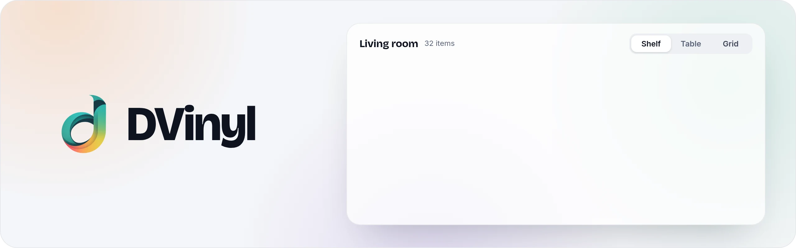

<p align="center">
  
</p>

<p align="center">
  <b>DVinyl</b> is a self-hosted manager for physical collections: records, books, films, games,
  LEGO, board games, trading cards, and any kind of item you define yourself.
</p>

<p align="center">
  <a href="https://demo.kyonew.me/"></a>
  <a href="./docs/getting-started.md"></a>
  <a href="https://github.com/Kyonew/DVinyl/wiki"></a>
</p>

<p align="center">
  
  
  
  
  
</p>

---

## Hey there 👋

DVinyl is a little home for your physical collection. It lives on your own server, pulls in cover
art and metadata from the big databases (Discogs, Hardcover, Open Library, TMDB, IGDB, ScreenScraper,
Rebrickable, BoardGameGeek), can even estimate what your records are worth, and lays it all out on
virtual shelves that look like the real ones, in a style you get to shape yourself. Everything lives
in one SQLite file: no database server to run.

DVinyl is **plugin based**: every media type is a plugin, so you turn on only what you care about,
and you can add your own type without touching the core.

Want to see it before installing anything? Have a look at the [live demo](https://demo.kyonew.me/), a
read-only preview of a finished instance.

## What it can do

### 📦 Your whole shelf, in one place
- **Many formats.** Music (vinyls, CDs, cassettes), books (manga, comics, hardcover), movies
  (Blu-ray, 4K, DVD, VHS, LaserDisc), video games and consoles, LEGO sets, board games and trading
  card games.
- **Your own types.** Collect something else? Create a new type right from the app with the no-code
  plugin editor, or write a [code plugin](./docs/plugin-development.md) with its own API.
- **Collector details.** Record size, speed, pressing plant, mastering and runouts per side from
  Discogs, film casts and original titles, several formats in one edition, boxsets holding their
  contents, and what you paid for each copy.
- **Multiple views & virtual shelves.** Browse in a grid, a compact table, or as realistic virtual
  shelves with spine view and customizable furniture.
- **Lists & playlists.** Curate custom lists within a collection and assemble tracks into playlists.
- **Multiple collections.** Keep separate libraries (yours, the family's, by room) and switch in one click.
- **Smart import & barcode scanner.** Add items by ID, scan physical barcodes with your camera, or
  bulk import existing libraries (Discogs with your own custom fields, Goodreads, any CSV).
- **Fast editing.** Edit one field on a whole selection, save and go on to the next item, saved
  filter views, and table columns per type.
- **AI assist.** Bring-your-own-key support for text, photo or barcode-fallback import, and for
  drafting a new no-code plugin from a one-sentence description. See the
  [AI Assist guide](./docs/ai.md) to set it up.
- **Market value & price history.** Live valuation estimates for your records, cards and board
  games, with historical charts over time.
- **Game completion times.** Playtime estimates powered by IGDB.
- **Printable labels.** Generate printable QR codes and barcodes for your physical media.
- **Wishlist.** Keep track of items you are hunting for.

### 🎨 Make it yours
- **A look per collection.** A studio with a live preview: ready-made styles, a top bar, sidebar or
  dock, your own colour palettes, fonts, card shapes, logo and background.
- **Home page widgets.** Arrange stats, latest additions, wishlist, lists and notes in a grid.
- **Collection info page.** Add a rich Markdown presentation page with photos for your collections.
- **In your pocket.** Installs on your phone like an app, with the barcode scanner one tap away.
- **Multilingual.** English, French, German, Spanish, Italian and Russian.

### 👥 Share it, your way
- **Users and roles.** Invite people to a collection as admin, editor or viewer, so everyone gets
  the right level of access, or send them a single-use invite link.
- **Requests & notifications.** Members ask each other to borrow an item or offer a gift, under
  types the admin makes up, with push notifications on their phone.
- **See each other's wishes.** Search results show who among your collections' members wishes for
  a record.
- **SSO login (OIDC).** Optional single sign-on with providers like Authentik, Keycloak, Authelia
  or pocketID, with optional automatic account creation from an identity provider group.
- **Public share links.** Generate a read-only link or QR code so anyone can browse a collection
  (or just part of it, e.g. only Vinyls) without an account.

### 💾 Your data stays yours
- **One file.** The whole collection in one SQLite file, easy to back up.
- **Backups.** Collection or whole-instance exports (ZIP with images, JSON, CSV), and automatic
  daily or weekly backups to a folder of your choice.
- **Local image copies.** Optionally download the covers that are only links, so they never vanish
  and travel in your backups.

## Supported media

| Type | Formats | Metadata source | API key |
| :--- | :------ | :-------------- | :-----: |
| Music | Vinyl, CD, cassette | Discogs | ✅ |
| Books | Books, manga, comics | Hardcover, Open Library | optional |
| Movies | Blu-ray, 4K, DVD, VHS, LaserDisc | TMDB | ✅ |
| Video games | Games, consoles | IGDB, ScreenScraper | ✅ |
| LEGO | Sets | Rebrickable | ✅ |
| Board games | Games, expansions | BoardGameGeek | ✅ |
| Trading cards | Pokémon, Magic, Yu-Gi-Oh!, One Piece, Lorcana, Star Wars: Unlimited, Digimon, Flesh and Blood | TCGdex, Scryfall, YGOPRODeck and others | none |

Each type can be turned on or off per collection. Add only the keys for the types you use: a type
whose key is missing stays disabled. See [API keys](./docs/api-keys.md) for where to get each one.

## Build your own type

DVinyl is made to grow with you. There are two ways to add a new kind of collection:

- **Plugin editor (no code).** Create a manual collection type right from the app, with your own
  fields, formats, icon and colors. No restart, no coding required. Short on ideas? The AI assist
  can draft one from a one-sentence description. See the
  [Plugin editor guide](https://github.com/Kyonew/DVinyl/wiki) on the Wiki.
- **Code plugin (with API).** Drop a `plugins/<id>/` folder that exports a plugin definition to add
  a full media type with its own external API, importers and stats.
  See the [Plugin development guide](./docs/plugin-development.md).

Built one you are proud of? Do not hesitate to open a PR, I would genuinely love to see it! 🙌

## Installation

### Docker Compose (recommended)

```yaml
services:
  dvinyl-app:
    image: ghcr.io/kyonew/dvinyl:latest
    container_name: dvinyl_app
    restart: unless-stopped
    ports:
      - "3099:3099"
    volumes:
      - ./data:/app/data # the SQLite database
      - ./public/uploads:/app/public/uploads # uploaded images
    env_file:
      - .env
```

Create a `.env` next to it from [.env.example](./.env.example). Two secrets are required:

```bash
PASSJWT= # openssl rand -hex 32
SESSION_SECRET= # openssl rand -hex 32, a different one
```

Then start it and open `http://your-server:3099` to create the first account:

```bash
docker compose up -d
```

More options (building from source, environment-only setup) are in the [Docker guide](./docs/docker.md).

### Other platforms

| Platform | How |
| :------- | :-- |
| Unraid | Community Applications, or the [XML template](https://raw.githubusercontent.com/Kyonew/DVinyl/main/unraid-template/dvinyl.xml) ([guide](./docs/getting-started.md#-unraid)) |
| ZimaOS / CasaOS | Add the source `https://raw.githubusercontent.com/NoNoBzH22/TwoBytes-Store/gh-pages` to the App Store, then install DVinyl ([guide](./docs/getting-started.md#-zimaos)) |
| Proxmox LXC | A small Debian container, no Docker ([guide](./docs/getting-started.md#-proxmox-lxc)) |
| Node.js | Run it directly on any machine ([guide](./docs/getting-started.md)) |

## Configuration

All settings live in `.env`; [.env.example](./.env.example) documents every variable. The most
common ones:

| Variable | Purpose |
| :------- | :------ |
| `PASSJWT`, `SESSION_SECRET` | Required secrets, two different random values |
| `SETUP_TOKEN` | Protects the first-run setup page while the instance is reachable by others |
| `PROD` | Set to `true` only when served over HTTPS |
| `VINYL_PORT`, `BASE_URL` | Port, and sub-path when served under one |
| `PUBLIC_URL`, `PUSH_CONTACT` | Public address, used for links and push notifications |
| `BACKUP_DIR` | Forces the folder for scheduled backups |
| `DISCOGS_TOKEN`, `TMDB_API_KEY`, `TWITCH_CLIENT_ID`… | Metadata providers ([API keys](./docs/api-keys.md)) |
| `OIDC_*` | Single sign-on ([details](./docs/getting-started.md#-environment-variables)) |
| `AI_*` | Optional AI import ([AI Assist](./docs/ai.md)) |

Behind a reverse proxy? See [the HTTPS section](./docs/getting-started.md#-behind-a-reverse-proxy-https).

## Updating

```bash
docker compose pull && docker compose up -d
```

Back up your `data/` folder first, or use the built-in backups. Coming from 3.x (MongoDB), your data
is moved to SQLite automatically on first start: read [Moving to SQLite](./docs/docker.md#-moving-to-sqlite)
before upgrading. Rolling back is covered in the [Docker guide](./docs/docker.md#rolling-back).

## Documentation

| Guide | Content |
| :---- | :------ |
| [Getting started](./docs/getting-started.md) | Installation options, environment variables, reverse proxy |
| [Docker deployment](./docs/docker.md) | Compose setup, updates, persistence, backups |
| [API keys](./docs/api-keys.md) | Discogs, Hardcover, TMDB, IGDB, ScreenScraper, Rebrickable, BoardGameGeek |
| [AI Assist](./docs/ai.md) | Bring-your-own-key AI import and plugin drafting |
| [Plugin development](./docs/plugin-development.md) | Build a media type as a code plugin |
| [Public share links](./docs/sharing.md) | Read-only links to a collection |
| [Wiki](https://github.com/Kyonew/DVinyl/wiki) | User guides and no-code tutorials |

**Tech stack:** Node.js, Express, SQLite, EJS, Tailwind CSS, i18next.

## Contributors

DVinyl is better for the people who jumped in. Huge thanks to everyone whose pull requests made it
into `main` 💜 (hover an avatar to see their merged PRs)

<p align="center">
  <a href="https://github.com/Siebe-Uy" title="Siebe-Uy · 13 merged PRs"></a>
  <a href="https://github.com/teaboyteaboy" title="teaboyteaboy · 6 merged PRs"></a>
  <a href="https://github.com/ArtwoXYZ" title="ArtwoXYZ · 4 merged PRs"></a>
  <a href="https://github.com/minchetas" title="minchetas · 3 merged PRs"></a>
  <a href="https://github.com/Sbax" title="Sbax · 3 merged PRs"></a>
  <a href="https://github.com/Kianuss" title="Kianuss · 2 merged PRs"></a>
  <a href="https://github.com/HolyFab" title="HolyFab · 2 merged PRs"></a>
  <a href="https://github.com/reneald" title="reneald · 2 merged PRs"></a>
  <a href="https://github.com/RobertClarke64" title="RobertClarke64 · 1 merged PR"></a>
  <a href="https://github.com/mistic100" title="mistic100 · 1 merged PR"></a>
  <a href="https://github.com/tonymarsh" title="tonymarsh · 1 merged PR"></a>
  <a href="https://github.com/guillaumegay13" title="guillaumegay13 · 1 merged PR"></a>
</p>

Want to see your name here? Bug reports, ideas, translations and plugins are all welcome. Please read
[CONTRIBUTING.md](./.github/CONTRIBUTING.md) and the [Code of Conduct](./.github/CODE_OF_CONDUCT.md)
first.

## License

[MIT](./LICENSE)

> [!NOTE]
> Parts of the frontend and comments were generated with the help of AI tools. I reviewed and
> corrected the output where needed, but this project is not 100% human-made. Feedback is very
> welcome, including on the backend, where I may have made mistakes. Thank you for your understanding <3
